 <h1 align="center">Vishnu Singamreddy</h1>
<h3 align="center">Python Full Stack Developer | React.js | JavaScript | SQL</h3>

  

  
  
  

---

## About

- B.Tech Computer Science graduate from Kalasalingam University (2026).
- Interested in Python, React.js, database development, and solving real-world problems.
- Building practical projects to strengthen development and problem-solving skills.
- Continuously learning new technologies and improving software development skills.

## Tech Stack

**Languages**

  
  
  
  
  

**Frontend**

  
  

**Database & Tools**

  
  
  
  
  

## Featured Projects

### 1. Job Application Tracker
A React-based application that helps users manage job applications, track application statuses, and organize their job search.

- React.js
- JavaScript
- Firebase Authentication
- Firebase Realtime Database
- CSS

**Links:** [GitHub Repository](https://github.com/VISHNUsingamreddy/job-application-tracker-using-react) | [Live Demo](https://vishnusingamreddy.github.io/job-application-tracker-using-react/login)

### 2. Attendance Monitoring System
A database-focused project designed to manage attendance records and perform CRUD operations.

- JavaScript
- HTML
- CSS
- MySQL

## GitHub Stats

  
  

  

## Connect With Me

  <a href="https://www.linkedin.com/in/vishnu-singamreddy/">LinkedIn</a> |
  <a href="https://portfolio-website-lqgm.vercel.app/">Portfolio</a> |
  <a href="https://github.com/VISHNUsingamreddy">GitHub</a>

